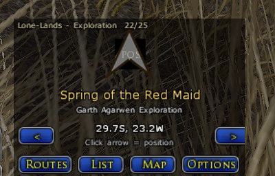
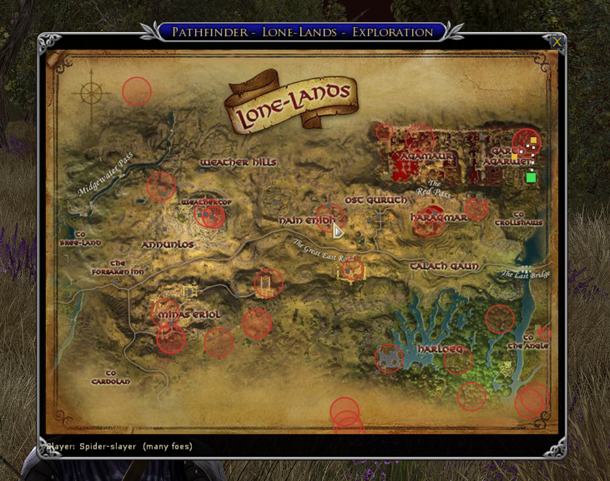
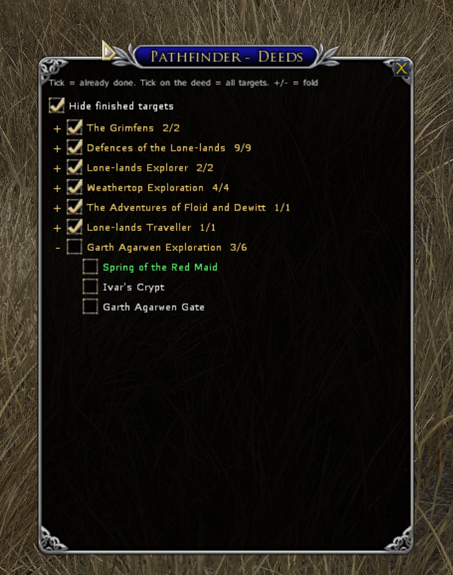
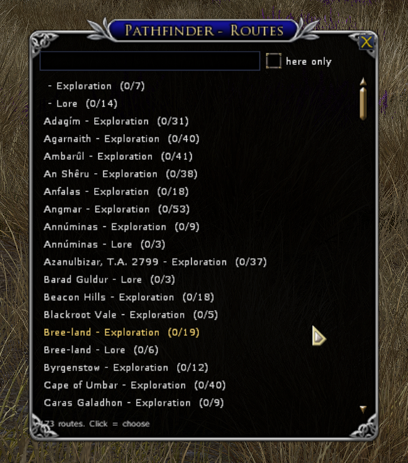
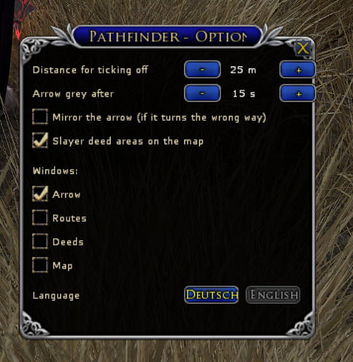

# Pathfinder

A Lord of the Rings Online plugin that guides you along a short route to the
targets of explorer and lore deeds: an arrow points to the next target, a map
shows the route, and a list lets you tick off what you already have. The map
also marks where the monsters of slayer deeds gather.
German and English clients are supported.

## Features

- **Arrow** to the next target, with the distance to it and the way left on
  the route below
- **Routes** precomputed as short tours: one per map and one per region over
  all its maps; both share the progress
- **Map** with the route; click a point to mark it done
- **List** to tick off targets and whole deeds you already have; finished
  targets can be hidden, deeds folded
- **Slayer areas**: red circles on the map where many foes of a slayer deed
  gather
- **Reroute** the open targets from where you stand
- German and English, following the game client

## Screenshots

**The arrow** is all you need while travelling. It names the next target
and its deed, and the top line shows the route and how far you are on it
(here 22 of 25 in the Lone-lands). Until you click it, the arrow knows no
position yet and shows the target's coordinates instead of the distance.
The buttons below open the other windows.



**The map** shows the whole route: open targets in yellow, the next one in
green, finished ones small and grey, white dots lead from one target to the
next. The red circles are slayer areas, the spots where most foes of a
slayer deed spawn, here the Spider-slayer in the Lone-lands. Click a target
to mark it done or open again.



**The deed list** groups the targets by deed. Tick what you already have
from before, a tick on a deed ticks all its targets. With *Hide finished
targets* only the open ones stay; completed deeds start folded.



**The route window** lists every route with its progress. Type a part of a
name to search; *here only* keeps the routes at your position.



**Options**: how close you must get to tick off a target, when the arrow
turns grey because your position is old, mirroring the arrow, slayer areas
on or off, which windows are shown, and the language.



## Install

Unpack the ZIP into `Documents\The Lord of the Rings Online\Plugins\` so that
the folder `Plugins\Pathfinder` exists. In game: `/plugins load Pathfinder`

## Usage

- **Click the arrow**: it runs `/loc` and updates your position. Tip: drag
  the arrow onto a quickbar and bind a key to that slot.
- `/pf here`: routes at your position
- `/pf list bree` searches routes, `/pf route 1` chooses one; the arrow starts
  at the open target nearest to you
- `/pf reroute`: new order of the open targets from where you stand
  (`/pf reset` brings back the original order)
- **Routes** button: search and choose routes, with progress ("here only":
  routes at your position)
- **List** button: tick off targets and deeds
- **Map** button: map with the route and slayer areas (`/pf slayer` turns
  them off)
- **Options**: radius, arrow, slayer areas, windows, language
- `/pf`: all commands; `/pf lang en|de` switches the language

## Why no automatic position?

The plugin API has no player position and plugins may not run commands on
their own, so `/loc` needs your click or key press. Single landmark
discoveries don't show up in chat, so targets are ticked off by position
(when you click near them or pass them between two clicks) or when the game
reports the whole deed as completed.

## Deutsch

Pathfinder führt dich auf einer vorberechneten kurzen Route zu den Zielen von
Erkundungs- und Wissens-Taten: ein Pfeil zeigt zum nächsten Ziel, eine Karte
zeigt die Route, in einer Liste hakst du ab, was du schon hast. Die Karte
zeigt außerdem, wo sich die Gegner von Slayer-Taten sammeln.

### Funktionen

- **Pfeil** zum nächsten Ziel, darunter die Entfernung und der restliche Weg
  der Route
- **Routen** als vorberechnete kurze Touren: eine pro Karte und eine pro
  Region über alle ihre Karten; beide teilen den Fortschritt
- **Karte** mit der Route; Punkt anklicken = erledigt an/aus
- **Liste** zum Abhaken von Zielen und ganzen Taten; erledigte Ziele
  ausblendbar, Taten einklappbar
- **Jagdgebiete**: rote Kreise auf der Karte, wo sich viele Gegner einer
  Slayer-Tat sammeln
- **Neu berechnen**: Reihenfolge der offenen Ziele ab deinem Standort
- Deutsch und Englisch, je nach Spiel-Client

### Installation

ZIP entpacken nach `Dokumente\The Lord of the Rings Online\Plugins\`, so dass
es den Ordner `Plugins\Pathfinder` gibt. Im Spiel: `/plugins load Pathfinder`

### Bedienung

- **Pfeil anklicken**: führt `/pos` aus und aktualisiert die Position. Tipp:
  den Pfeil auf eine Schnellleiste ziehen und den Platz auf eine Taste legen.
- `/pf hier`: Routen an deiner Position
- `/pf liste bree` sucht Routen, `/pf route 1` wählt eine; der Pfeil beginnt
  beim offenen Ziel, das dir am nächsten ist
- `/pf neu`: Reihenfolge der offenen Ziele ab deinem Standort neu berechnen
  (`/pf reset` stellt die ursprüngliche wieder her)
- Knopf **Routen**: Routen suchen und wählen, mit Fortschritt ("nur hier":
  Routen an deiner Position)
- Knopf **Liste**: Ziele und Taten abhaken
- Knopf **Karte**: Karte mit Route und Jagdgebieten (`/pf jagd` schaltet sie
  aus)
- **Optionen**: Radius, Pfeil, Jagdgebiete, Fenster, Sprache
- `/pf`: alle Befehle; `/pf sprache de|en` stellt die Sprache um

### Warum keine automatische Position?

Die Plugin-Schnittstelle kennt keine Spielerposition, und Plugins dürfen keine
Befehle selbst ausführen. `/pos` braucht deshalb deinen Klick oder
Tastendruck. Einzelne entdeckte Orte erscheinen nicht im Chat, deshalb werden
Ziele über die Position abgehakt (Klick in der Nähe oder vorbeigelaufen
zwischen zwei Klicks) oder wenn das Spiel die ganze Tat als abgeschlossen
meldet.

## Credits

Deed coordinates, names, monster spawns and map images: LotroCompanion
([lotro-data](https://github.com/LotroCompanion/lotro-data),
[lotro-maps-db](https://github.com/LotroCompanion/lotro-maps-db)), originally
from the game data of The Lord of the Rings Online (Standing Stone Games).
`/loc` conversion formula as in the Waypoint plugin by Lunarwater.
Source code: [github.com/mennigju/lotro-pathfinder](https://github.com/mennigju/lotro-pathfinder)
(MIT license).

<!-- end of LotroInterface description -->

---

The text above is also the LotroInterface description
(`tools/readme_bbcode.py`). The ZIP carries the same player documentation as
[plugin/Pathfinder/README.txt](plugin/Pathfinder/README.txt).

## Layout

| Path | Content |
|---|---|
| `plugin/Pathfinder/` | The plugin as it goes into the LOTRO `Plugins` folder |
| `plugin/Pathfinder/Route/Routes/` | Generated routes, one Lua file per map and deed type (`R*`), per region (`G*`); slayer areas per map (`A*_SLAYER.lua`) |
| `plugin/Pathfinder/Route/Resources/` | Arrow frames and rings (generated) and map images (generated) |
| `tools/` | Generators, tests and packaging |

## Development

```sh
python3 -I tools/fetch_data.py        # LotroCompanion data -> cache/ (--markers: +650 MB monster spawns)
python3 -I tools/build_routes.py      # routes + map JPGs (--scale 0.6, --map, --types, --no-areas)
python3 -I tools/make_images.py       # 36 rotated arrow frames per arrow, area rings
lua5.1 tools/test_loc.lua             # tests for parsing, geometry and route state
python3 -I tools/package.py           # dist/Pathfinder-<version>.zip (--version, default git describe)
python3 -I tools/readme_bbcode.py     # dist/lotrointerface.txt: description as BBCode
python3 -I tools/summarize_changes.py # Markdown summary of the regenerated routes vs. HEAD
```

`tools/map_sources.txt` records the hash of each map's source PNG; a map JPG
is only encoded again when its PNG or the scale changes.

The slayer areas need the map markers (`fetch_data.py --markers`): every
spawn point, once per monster that may appear there. `build_routes.py`
matches the slayer deeds' monster selection against `mobs.xml`, takes the
deed's map (or the map of the territory it names) and puts circles on the
densest spots. Deeds it can't place are listed in
`cache/slayer_unmatched.txt`, targets without a map in
`cache/dropped_targets.txt`. Without the markers (or with `--no-areas`)
the existing area files stay as they are.

The data update workflow (`.github/workflows/data-update.yml`, Mondays or
by hand via *Run workflow*) fetches the current LotroCompanion data including
the markers, rebuilds routes, maps and slayer areas and, if anything changed,
opens or updates a PR from the branch `data-update` whose text lists the
changed routes, areas and maps. PRs opened by the workflow's token don't
trigger CI, so the workflow runs the syntax check and the tests itself; it
needs *Allow GitHub Actions to create and approve pull requests* in the
repository's Actions settings.

For local testing, link `plugin/Pathfinder` into the game's `Plugins` folder
and run `/plugins load Pathfinder` in game.

Notes on the LOTRO plugin API that shaped the design:

- There is no player position in the API. The position comes from the `/loc`
  (`/pos` on German clients) chat output; plugins may not run commands
  themselves, so a quickslot under the arrow runs it on click.
- Controls cannot be rotated, hence 36 pre-rendered arrow images.
- Game map images could not be shown by resource ID, so the maps ship as JPGs
  in their final size (the game does not scale them reliably).
- Discovering a single landmark writes nothing to chat; only a completed deed
  does (`Abgeschlossen:` / `Completed:`).
- The German client's `tonumber()` expects a decimal comma.

## Releasing

CI (`.github/workflows/ci.yml`) runs the syntax check, the tests and the
packaging on every push to `main` and on pull requests; the ZIP is attached
as a build artifact.

1. Push a tag (`git tag v0.6 && git push origin v0.6`). The tag is the only
   place the version is set: `Route.plugin` in the repository says `dev`,
   `package.py` writes the version into the copy inside the ZIP.
2. The release workflow runs the tests, builds the ZIP and
   `lotrointerface.txt` and publishes a GitHub release with both.
3. On LotroInterface, open the add-on and choose *Update*: upload the ZIP
   from the release, enter the version and paste the release notes as the
   change log.
4. If the description above changed, replace the description with the
   content of `lotrointerface.txt`. Upload new screenshots
   (`docs/screenshots/`) to the add-on's gallery when the windows changed,
   with the captions from the Screenshots section.

## License

Code: [MIT](LICENSE), Copyright (c) 2026 jmennig.

Deed coordinates, names and map images come from
[LotroCompanion](https://github.com/LotroCompanion) (`lotro-data`,
`lotro-maps-db`) and originally from the game data of The Lord of the Rings
Online (Standing Stone Games). They are not covered by the MIT license.
The `/loc` conversion formula follows the Waypoint plugin by Lunarwater.
